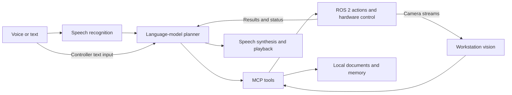

# System architecture

The system distributes work across a web controller, a GPU workstation, and a Stretch 3 robot. ROS 2 carries sensor data, commands, and action results between the machines.

## Responsibilities

| Component | Responsibility |
| --- | --- |
| Controller | Connect to machines over SSH, deploy systemd user services, start and stop nodes, and show logs and status |
| Workstation | Process speech and images, run local models, plan tasks, and expose robot capabilities through MCP |
| Robot | Read sensors, localize and navigate, control hardware, execute manipulation actions, and play audio |

The controller can share a host with the workstation. Each workstation and robot pair uses a matching ROS domain ID and a shared discovery server.

## Requests and results

Spoken requests pass through voice detection and transcription. Text input enters through the controller. The planner selects tools for navigation, manipulation, perception, communication, or information retrieval. MCP tools translate those calls into ROS actions and services.

Action results return to the planner so it can report completion or explain a failure. Speech synthesis runs on the workstation; playback runs on the robot. The planner page shows requests, tool calls, and results while a task runs.

## Perception and knowledge

The robot streams camera data to workstation vision nodes for object detection, scene interpretation, and optional face recognition. Optional speaker recognition associates speech with locally enrolled users.

Local document retrieval supplies organization-specific answers. Remembered facts form a separate editable store. Source texts, generated indexes, and recognition enrollment data have separate lifecycles; see [Configuration](configuration.md#local-knowledge).

## Motion and supervision

Robot-side services control motion and enforce hardware and action constraints. The planner requests actions through these services. Cancellation, recovery state, and action feedback coordinate task termination and subsequent requests.

Object possession is a stored operating assumption based on completed actions and operator corrections. It is not direct sensor proof. Transfers require a fresh thumbs-up after the robot presents its gripper.

An operator must supervise movement and remain able to use the physical runstop. [Daily operation](usage.md) describes the operating procedure.

## Deployment

The controller generates systemd user services from the shared node configuration. Each machine builds and runs its own ROS workspace. Fast DDS discovery connects participants across the dedicated network; RViz uses a diagnostic discovery profile.

Models and node settings live in YAML configuration files. The installation and update scripts manage dependencies and workspace builds. See [Developer onboarding](development.md) for the main source directories.
